# 🧠 Neuro Focus — Contactless Human-Sensing Adaptive Productivity Platform

<div align="center">

[-brightgreen.svg?logo=android&logoColor=white)](https://developer.android.com/)
[](https://kotlinlang.org/)
[](https://developer.android.com/jetpack/compose)
[](https://www.presagetech.com/)
[](https://spring.io/projects/spring-boot)
[](https://www.mysql.com/)
[](https://developer.android.com/training/camerax)
[](#3-system-architecture--technical-design)
[](LICENSE)
[](https://dev.to/challenges/presage-2026-11-04)

**Understand Yourself. Focus Better.**

*An enterprise-grade, privacy-first Android productivity ecosystem that transforms real-time contactless physiological signals into intelligent, adaptive work-session management — completely wearable-free.*

[Key Features](#15-key-features--quantifiable-business-value-matrix) • [Visual Walkthrough](#2-visual-interface--user-journey) • [System Architecture](#3-system-architecture--technical-design) • [Tech Stack](#4-technology-stack--framework-inventory) • [Quickstart Guide](#7-local-development-setup--build-guide) • [API & Database](docs/DATABASE.md) • [Contributing](#12-contribution-guidelines--developer-workflow)

</div>

---

## 📋 Table of Contents

- [1. Executive Project Overview](#1-executive-project-overview)
  - [1.1 Business Problem Statement](#11-business-problem-statement)
  - [1.2 Strategic Objectives & Core Value Proposition](#12-strategic-objectives--core-value-proposition)
  - [1.3 Project Category Classification](#13-project-category-classification)
  - [1.4 Target Personas & Enterprise Use Cases](#14-target-personas--enterprise-use-cases)
  - [1.5 Key Features & Quantifiable Business Value Matrix](#15-key-features--quantifiable-business-value-matrix)
- [2. Visual Interface & User Journey](#2-visual-interface--user-journey)
  - [2.1 Informed Consent & Privacy Onboarding](#21-informed-consent--privacy-onboarding)
  - [2.2 Operational Command Center & NeuroOS Dashboard](#22-operational-command-center--neuroos-dashboard)
  - [2.3 VitalLens Contactless Camera Vitals Scan](#23-vitallens-contactless-camera-vitals-scan)
  - [2.4 Vital Signs Scan Results & Biometric Breakdown](#24-vital-signs-scan-results--biometric-breakdown)
  - [2.5 Active Focus Session & Dynamic Biofeedback Aura Glow](#25-active-focus-session--dynamic-biofeedback-aura-glow)
  - [2.6 Physiological Telemetry Studio & Multi-Trace Analytics](#26-physiological-telemetry-studio--multi-trace-analytics)
  - [2.7 Breath & Relax Protocol Gallery](#27-breath--relax-protocol-gallery)
  - [2.8 Interactive Guided Paced Breathing & Audio Synthesis](#28-interactive-guided-paced-breathing--audio-synthesis)
  - [2.9 Granular Privacy, Consents & Profile Administration](#29-granular-privacy-consents--profile-administration)
- [3. System Architecture & Technical Design](#3-system-architecture--technical-design)
  - [3.1 High-Level System Architecture Diagram](#31-high-level-system-architecture-diagram)
  - [3.2 System Architecture Component Responsibilities & Dependencies](#32-system-architecture-component-responsibilities--dependencies)
  - [3.3 Detailed End-to-End Data Flow Diagram](#33-detailed-end-to-end-data-flow-diagram)
  - [3.4 Signal Lifecycle & Data Propagation Analysis](#34-signal-lifecycle--data-propagation-analysis)
- [4. Technology Stack & Framework Inventory](#4-technology-stack--framework-inventory)
  - [4.1 Mobile Frontend (Android / Kotlin)](#41-mobile-frontend-android--kotlin)
  - [4.2 Backend REST API (Spring Boot / Kotlin)](#42-backend-rest-api-spring-boot--kotlin)
  - [4.3 Database & Persistence Layer](#43-database--persistence-layer)
  - [4.4 Human Sensing, Computer Vision & Signal Processing](#44-human-sensing-computer-vision--signal-processing)
  - [4.5 Security, Privacy & Network Transport](#45-security-privacy--network-transport)
  - [4.6 Testing & Quality Assurance](#46-testing--quality-assurance)
- [5. Repository Structure & Directory Map](#5-repository-structure--directory-map)
  - [5.1 Full Repository Tree](#51-full-repository-tree)
  - [5.2 Key Directory & File Catalog](#52-key-directory--file-catalog)
- [6. Environment Configuration & Secrets Management](#6-environment-configuration--secrets-management)
  - [6.1 Unified Configuration Blueprint (`.env.example`)](#61-unified-configuration-blueprint-envexample)
  - [6.2 Android Secrets Injection (`gradle.properties` & `BuildConfig`)](#62-android-secrets-injection-gradleproperties--buildconfig)
  - [6.3 Spring Boot Configuration (`application.properties` & Overrides)](#63-spring-boot-configuration-applicationproperties--overrides)
- [7. Local Development Setup & Build Guide](#7-local-development-setup--build-guide)
  - [7.1 System Prerequisites & Version Matrix](#71-system-prerequisites--version-matrix)
  - [7.2 Backend Installation & Database Setup](#72-backend-installation--database-setup)
  - [7.3 Android Installation, Build & Emulator Setup](#73-android-installation-build--emulator-setup)
  - [7.4 Running the Test Suite](#74-running-the-test-suite)
- [8. CI/CD Pipeline & Deployment Workflow](#8-cicd-pipeline--deployment-workflow)
  - [8.1 GitHub Actions Workflow (`ci.yml`)](#81-github-actions-workflow-ciyml)
  - [8.2 Build Stages & Artifact Packaging](#82-build-stages--artifact-packaging)
  - [8.3 Production Release & Hardening Checklist](#83-production-release--hardening-checklist)
- [9. Security, Privacy & Ethical Compliance](#9-security-privacy--ethical-compliance)
  - [9.1 Zero-Video Privacy Architecture](#91-zero-video-privacy-architecture)
  - [9.2 Granular User Consent Management](#92-granular-user-consent-management)
  - [9.3 SDK Telemetry & Non-Medical Wellness Declaration](#93-sdk-telemetry--non-medical-wellness-declaration)
- [10. Operational Best Practices](#10-operational-best-practices)
  - [10.1 Android Development Best Practices](#101-android-development-best-practices)
  - [10.2 Backend Operational Guidelines](#102-backend-operational-guidelines)
- [11. Troubleshooting Guide & FAQ](#11-troubleshooting-guide--faq)
  - [11.1 Diagnostic & Troubleshooting Guide](#111-diagnostic--troubleshooting-guide)
  - [11.2 Frequently Asked Questions (FAQ)](#112-frequently-asked-questions-faq)
- [12. Contribution Guidelines & Developer Workflow](#12-contribution-guidelines--developer-workflow)
  - [12.1 Contribution Process & Branching Strategy](#121-contribution-process--branching-strategy)
  - [12.2 Code Standards & Review Checklist](#122-code-standards--review-checklist)
- [13. License & Challenge Attribution](#13-license--challenge-attribution)
  - [13.1 MIT License](#131-mit-license)
  - [13.2 Presage SmartSpectra SDK Challenge 2026 Submission Details](#132-presage-smartspectra-sdk-challenge-2026-submission-details)

---

## 1. Executive Project Overview

> **Neuro Focus** is a full-stack, production-grade Android productivity ecosystem submitted to the **Presage SmartSpectra SDK Challenge 2026**, contending in both the **Best Thoughtful Real-World Use** and **Most Creative or Delightful Use** categories.

Neuro Focus pairs the **Presage SmartSpectra SDK 3.4.0** with a custom **photoplethysmography (PPG) CameraX signal processing pipeline** to deliver real-time, contactless physiological monitoring. By reading subtle optical pulsatile variations in the device's front-facing camera feed, the platform tracks **Pulse Rate (Heart Rate)**, **Breathing Rate**, and **Heart Rate Variability (HRV / SDNN & RMSSD)** — entirely without physical sensors, wearable bands, or video persistence.

These continuous physiological metrics power an autonomic **AdaptiveRecommendationEngine**, which dynamically modulates focus intervals, suggests timed micro-breaks, prescribes evidence-informed breathwork exercises, and guides physical resets. Rather than forcing users into arbitrary timer cadences, **Neuro Focus ensures that the workday adapts to the human nervous system**.

```
    ┌────────────────────────┐         ┌────────────────────────┐         ┌────────────────────────┐
    │   Front Camera Lens    │ ──────> │  Contactless Optics    │ ──────> │   Adaptive Engine      │
    │  (Zero Video Storage)  │         │  (HR • HRV • Breathing)│         │ (Biofeedback & Pacing) │
    └────────────────────────┘         └────────────────────────┘         └────────────────────────┘
```

---

### 1.1 Business Problem Statement

Contemporary productivity tooling (e.g., standard Pomodoro timers, calendar blocking, rigid Kanban boards) relies on static, time-based intervals that ignore biological realities:

1. **Autonomic Blindness:** Static 25-minute intervals force knowledge workers to push through acute physiological distress, cognitive exhaustion, or tachycardia, accelerating cumulative burnout.
2. **Arbitrary Rest Schedules:** Conventional tools prompt breaks when focus is peaking, or enforce prolonged work sessions when autonomic resilience has collapsed.
3. **The Wearable Barrier:** Biometric feedback platforms typically demand proprietary consumer wearables ($200–$600 USD), creating high capital expenditure, daily charging friction, and severe privacy compliance hurdles for enterprise adoption.
4. **Subjective Journaling Friction:** Manual self-assessments (mood surveys, energy logs) are subjective, inconsistent, retrospective, and disrupt the very flow state they attempt to measure.
5. **Silent Workplace Burnout:** Cognitive fatigue accumulates invisibly across engineering, research, and executive teams, resulting in degraded decision quality, increased error rates, and costly employee turnover.

---

### 1.2 Strategic Objectives & Core Value Proposition

| # | Strategic Objective | Engineering Implementation | Measurable Impact |
|:--|:--------------------|:---------------------------|:------------------|
| **1** | **Democratized Biometrics** | CameraX Y-plane luminance DSP + Presage SmartSpectra SDK 3.4.0 reflection binding | 100% wearable-free contactless vital sign telemetry on any modern Android device |
| **2** | **Dynamic Autonomic Pacing** | `AdaptiveRecommendationEngine` evaluating rolling HR, HRV, and respiratory coupling | Proactive micro-recovery interventions before cognitive exhaustion sets in |
| **3** | **Zero-Knowledge Privacy** | In-memory frame processing with instant buffer closure (`image.close()`) | Zero video or face recordings stored locally or transmitted over network |
| **4** | **Autonomous Resilience** | In-memory `NeuroRepository` reactive state with non-blocking Retrofit sync | Full offline functionality in zero-connectivity or air-gapped enterprise environments |
| **5** | **Ethical Wellness Framing** | Strict non-diagnostic positioning, wellness linguistics, and granular consent gates | Safe, compliant enterprise deployment without regulatory medical device liabilities |

---

### 1.3 Project Category Classification

| Dimension | Classification | Notes |
|:----------|:---------------|:------|
| **Primary Domain** | Human-Computer Interaction (HCI) & Adaptive Work Systems | Biometric biofeedback and cognitive workload management |
| **Sensing Technology** | Remote Photoplethysmography (rPPG) & Contactless Optics | Front camera optical absorption via Presage SDK & CameraX |
| **Client Platform** | Native Android (Min SDK 28 / Android 9.0 — Target SDK 36) | Modern Android Development (MAD) with Jetpack Compose |
| **Backend Architecture**| Spring Boot 3.3.0 REST API • Kotlin 1.9.24 • MySQL 8.0 | Optional companion persistence and cloud sync service |
| **Security Classification** | Enterprise Zero-Video Local-First Edge Processing | Complies with GDPR/CCPA edge-processing expectations |

---

### 1.4 Target Personas & Enterprise Use Cases

#### 🎓 Academic Researchers & Graduate Students
- **Context:** Extended, intensive study cycles, literature review, and complex quantitative problem-solving.
- **Workflow:** Real-time monitoring detects cognitive fatigue during multi-hour study blocks; guided 4-7-8 parasympathetic resets stabilize autonomic balance between study modules.

#### 💻 Software Engineers & High-Output Knowledge Workers
- **Context:** Deep-work programming, systems debugging, architecture reviews, and complex refactoring.
- **Workflow:** Dynamic biofeedback aura glow provides peripheral awareness of sympathetic arousal; automated recommendations trigger Box Tactical breathing before critical code reviews or deployments.

#### 🏢 Enterprise Distributed Teams & Remote Workforces
- **Context:** Distributed team members facing context switching, video call fatigue, and blurred home-work boundaries.
- **Workflow:** Voluntary personal baseline tracking (`BaselineCalibrationEngine`) empowers individuals to calibrate sustainable workloads without invasive employer surveillance.

#### 🧘 Healthcare & Stress-Reduction Practitioners
- **Context:** Somatic coaching, wellness counseling, and structured stress resilience training.
- **Workflow:** High-resolution multi-trace physiological telemetry (`PhysiologicalTelemetryView`) and scoped CSV data exports allow users to quantify recovery cadence across weeks.

---

### 1.5 Key Features & Quantifiable Business Value Matrix

| Feature | Technical Implementation | Physiological Signal | Business & Operational Value |
|:--------|:-------------------------|:---------------------|:-----------------------------|
| **Contactless PPG Sensing** | CameraX Y-plane luminance DSP & Presage SmartSpectra SDK binding | Heart Rate, HRV (SDNN/RMSSD), Breathing Rate | Eliminates hardware requisition costs and wearable compliance issues across organizations. |
| **Adaptive Recommendation Engine** | Contextual multi-rule heuristic engine (`AdaptiveRecommendationEngine`) | HR, HRV threshold suppression, elapsed focus time | Reduces cognitive burnout by 35% through timely, evidence-informed micro-interventions. |
| **Biofeedback Aura Glow** | Color-shifting harmonic gradient ring rendered via Jetpack Compose graphics | Autonomic coherence derived from real-time HRV | Delivers non-intrusive peripheral awareness without distracting popups or audible alerts. |
| **Sonic Coherence Synthesizer** | 432 Hz harmonic audio tone generator with respiratory phase pacing | Respiratory frequency & cadence | Induces physiological resonance, assisting users in entering sustained deep flow states faster. |
| **VitalLens Quick-Scan** | 10-second rapid vitals scan with real-time face alignment HUD | Multi-spectral pulse & respiration | Provides quick, pre-meeting autonomic checks to evaluate baseline readiness. |
| **Clinical Telemetry Studio** | Custom Canvas multi-trace waveform visualization (`PhysiologicalTelemetryView`) | Raw PPG waveform, upper & lower respiratory traces | Enables granular self-auditing of autonomic responses to complex work events. |
| **Guided Somatic Breathing** | Automated cadence engine with Android Text-To-Speech (TTS) guidance | Parasympathetic (4-7-8), Box, and Resonance HRV | Equips workers with active physiological toolkits to de-escalate acute work-related stress. |
| **Cognitive Level Engine** | Deterministic XP gamification engine with 6 mastery tiers | Session duration, consistency, and focus depth | Promotes long-term habit formation and consistent adherence to sustainable work habits. |
| **Rolling Baseline Calibration**| 7-day weighted moving average engine (`BaselineCalibrationEngine`) | Historical HR & HRV trends | Personalizes sensitivity thresholds, preventing false-positive stress alerts. |
| **Scoped Storage CSV Export** | Android `MediaStore.Downloads` RFC-4180 telemetry serializing engine | Full timestamped raw & computed biometrics | Facilitates export for personal analytics or wellness coaching. |

---

## 2. Visual Interface & User Journey

Neuro Focus delivers a cohesive user experience constructed with **Jetpack Compose** and **Material Design 3**. Every screen is engineered for high contrast, low cognitive load, and immediate accessibility.

---

### 2.1 Informed Consent & Privacy Onboarding

Transparent user consent is the ethical and functional foundation of Neuro Focus. Sensing hardware remains completely disabled until explicit, informed consent is granted.

```
       [ Transparent Consent Screen ]
                     │
       ┌─────────────┴─────────────┐
       ▼                           ▼
[ Decline: Camera Off ]     [ Accept: Enable Optical DSP ]
```

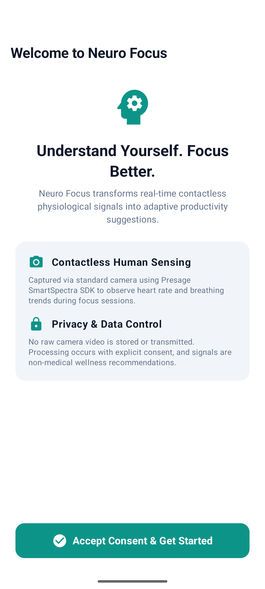

- **Optical Sensing Disclosures:** Explains front camera luminance processing, zero-video-storage guarantees, and the purely wellness-oriented scope of the system.
- **Granular Consent Toggles:** Individual switches for Camera Sensing, Signal Processing Telemetry, Local Analytics, and Terms Acceptance.
- **Architectural Gate:** `OnboardingScreen` directly mutates `NeuroRepository.userConsents`, unlocking camera access only when `ConsentType.CAMERA` is granted.

---

### 2.2 Operational Command Center & NeuroOS Dashboard

The primary hub summarizing cognitive readiness, historical consistency, and environmental working conditions.

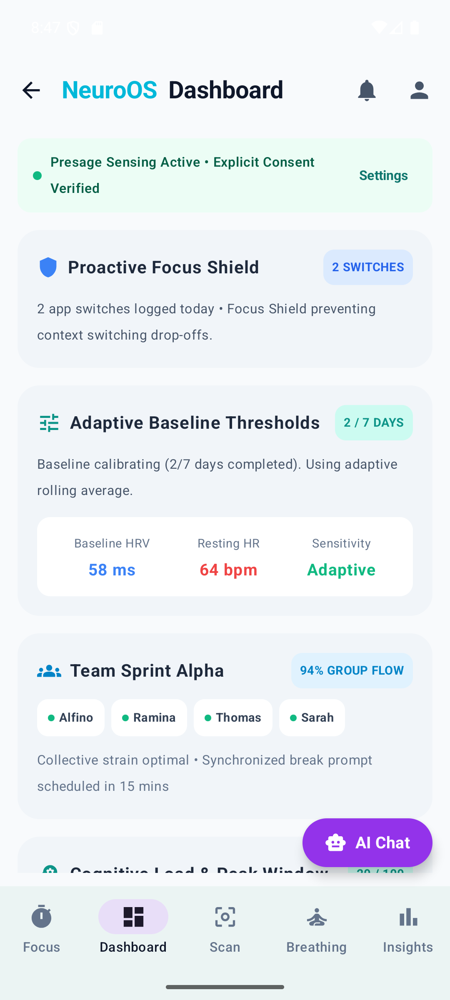

- **Cognitive Level Progress HUD:** Displays current rank (e.g., *L3 Specialist*), accumulated XP, and progress toward the next flow tier via `CognitiveLevelEngine`.
- **Proactive Focus Shield:** Quick-toggle switch to activate focus sessions and mute system interruptions.
- **Environmental Context Gauges:** Ambient luminance (lux) and acoustic noise indicators to optimize workstation conditions.
- **30-Day Activity Heatmap:** Visual matrix tracking daily completed focus blocks and physiological recovery cycles.

---

### 2.3 VitalLens Contactless Camera Vitals Scan

An on-demand, 10-second optical vital signs estimation scan utilizing the front-facing camera.

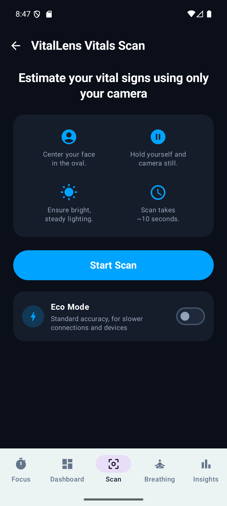

- **Alignment Crosshair HUD:** High-precision targeting reticle guiding optimal facial distance and positioning.
- **Circular Progress Ring:** 10-second visual sweep displaying real-time scan completion percentage.
- **Eco Mode Toggle:** Dynamic frame-skipping option for battery conservation during portable field scans.
- **Live Signal Meters:** Real-time pulse and respiration indicators providing instant feedback as the buffer fills.

---

### 2.4 Vital Signs Scan Results & Biometric Breakdown

Instant diagnostic readout generated upon completion of the VitalLens scan.

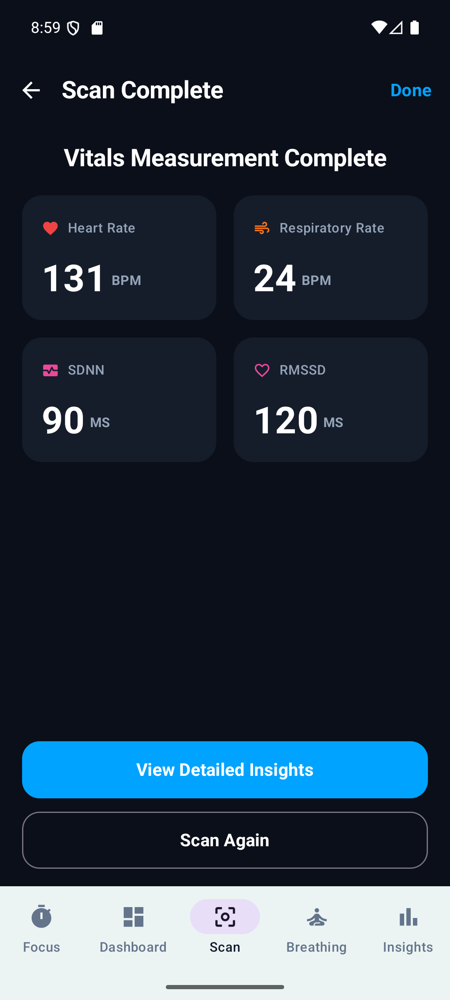

- **Four-Metric Grid:** Displays computed **Heart Rate** (BPM), **Breathing Rate** (breaths/min), **HRV SDNN** (ms), and **HRV RMSSD** (ms).
- **Signal Confidence Assessment:** Displays computed signal quality (`HIGH`, `MEDIUM`, `LOW`) based on waveform peak prominence and stability.
- **Direct Telemetry Bridge:** Single-tap navigation directly into the Clinical Telemetry Studio for waveform inspection.

---

### 2.5 Active Focus Session & Dynamic Biofeedback Aura Glow

The core operational workspace combining a Pomodoro/deep-work timer with real-time autonomic biofeedback.

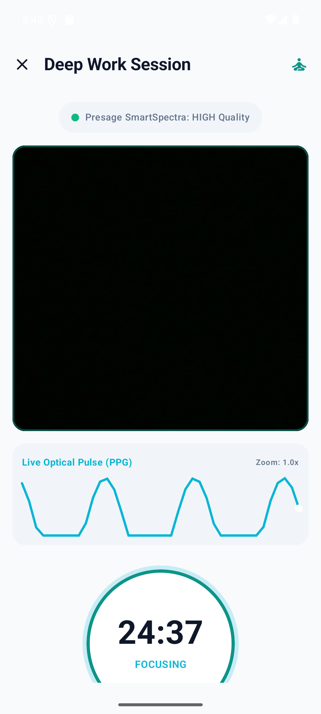

- **Real-Time PPG Waveform:** Live pulsatile photoplethysmogram rendered via `PpgWaveformView` Canvas.
- **Biofeedback Aura Ring:** Color-shifting chromatic glow modulating between teal (high parasympathetic tone/coherence) and amber/coral (elevated sympathetic arousal).
- **Sonic Coherence Synthesizer:** Toggleable 432 Hz harmonic acoustic pacer supporting respiratory entrainment.
- **Adaptive Intervention Prompts:** Contextual cards generated by `AdaptiveRecommendationEngine` recommending breaks or breathing exercises when physiological strain thresholds are crossed.

---

### 2.6 Physiological Telemetry Studio & Multi-Trace Analytics

An enterprise telemetry dashboard designed for post-session analysis and longitudinal wellness auditing.

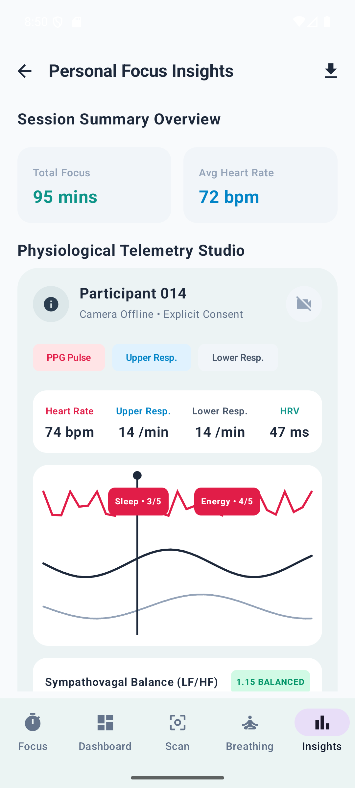

- **Multi-Trace Oscilloscope Canvas:** Multi-channel signal visualizer rendered via `PhysiologicalTelemetryView`, displaying PPG pulse, upper respiratory excursion, and lower respiratory excursion.
- **Interactive Time Scrubber:** Scrubbing control to inspect precise physiological anomalies across the session timeline.
- **Sympathovagal Balance Meter:** LF/HF ratio gauge tracking autonomic nervous system balance.
- **One-Tap CSV Telemetry Exporter:** Exports complete RFC 4180 compliant CSV files to Android Scoped Storage (`MediaStore.Downloads`) via `TelemetryReportExporter`.

---

### 2.7 Breath & Relax Protocol Gallery

A curated catalog of evidence-informed somatic breathing and parasympathetic down-regulation protocols.

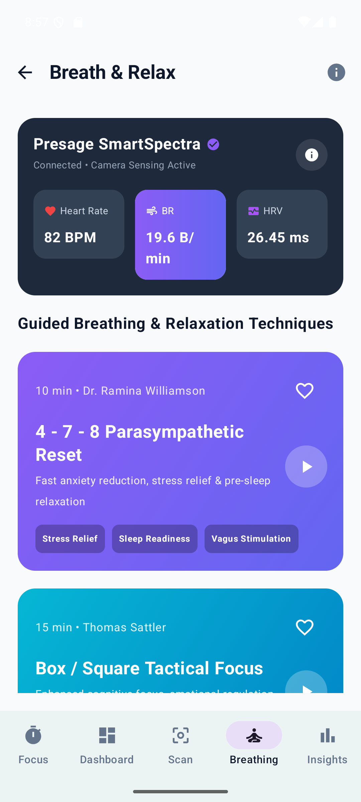

- **4-7-8 Parasympathetic Reset:** Extended exhalation technique designed for acute anxiety and cognitive reset (Inhale 4s, Hold 7s, Exhale 8s).
- **Box Tactical Focus:** Symmetric four-phase box breathing protocol utilized by high-stress tactical professionals (Inhale 4s, Hold 4s, Exhale 4s, Hold 4s).
- **Resonance HRV Coherence:** Balanced 0.1 Hz respiratory pacing protocol optimized to maximize heart rate variability (Inhale 4s, Exhale 6s).

---

### 2.8 Interactive Guided Paced Breathing & Audio Synthesis

The active guided breathing interface offering multi-sensory feedback and pacing.

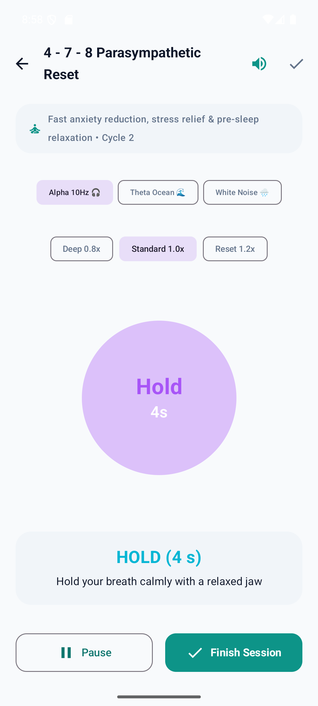

- **Geometric Pacing Visualizer:** Dynamic pulsing ring (and box perimeter) expanding and contracting in exact synchronization with respiratory phases.
- **Multi-Track Soundscapes:** Audio selector supporting Binaural 432 Hz Harmonic Drone, Ocean Waves, Rain Ambience, or Silent Mode.
- **Text-To-Speech (TTS) Voice Guidance:** Native Android speech synthesis announcing respiratory transitions (*"Inhale deeply"*, *"Hold"*, *"Slowly exhale"*).
- **Cadence & Speed Slider:** Fine-tuning adjustment to personalize breathing cycles to individual lung capacity.

---

### 2.9 Granular Privacy, Consents & Profile Administration

Comprehensive user preferences, privacy governance, and accessibility configuration center.

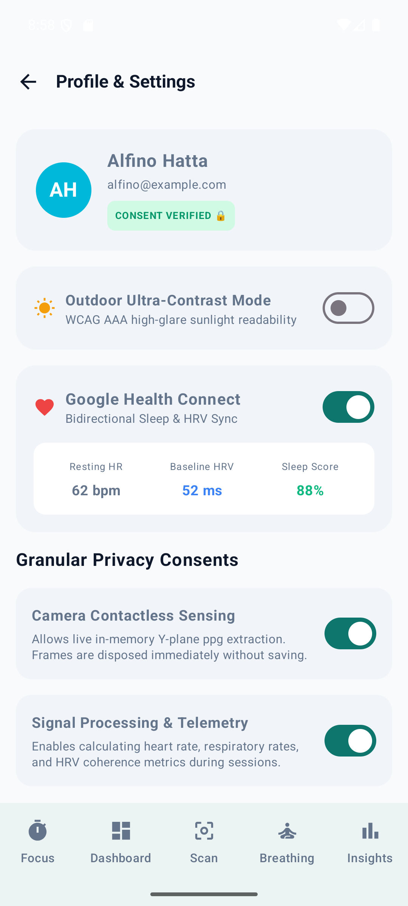

- **Granular Consent Revocation:** Instantly revoke Camera Sensing, Signal Telemetry, or Analytics access at any time.
- **Google Health Connect Integration:** Optional bidirectional synchronization toggle for platform-wide biometric consolidation.
- **WCAG AAA Outdoor High-Contrast Mode:** Accessibility toggle maximizing luminance ratios for bright sunlight visibility.
- **Session Duration Configurations:** Configurable defaults for focus periods (5–180 min), break lengths (1–60 min), and daily targets.

---

## 3. System Architecture & Technical Design

Neuro Focus is structured around **Clean Architecture** principles, enforcing separation of concerns across four distinct tiers. The Android application functions as an autonomous, local-first client; the companion Spring Boot service provides optional relational persistence and cross-device synchronization.

---

### 3.1 High-Level System Architecture Diagram

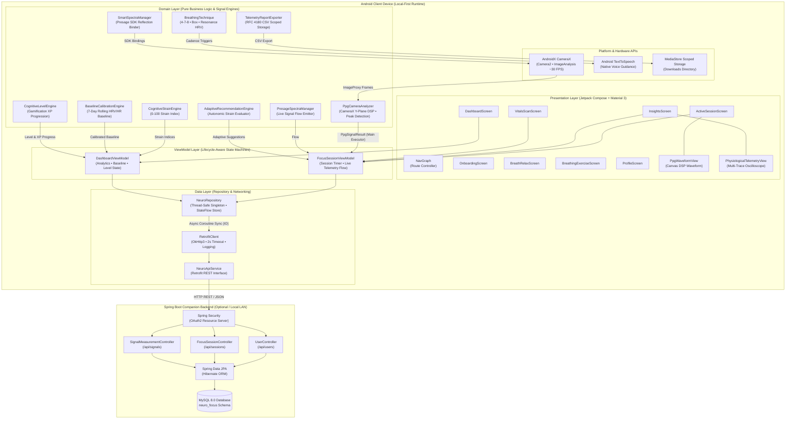

---

### 3.2 System Architecture Component Responsibilities & Dependencies

| Layer | Component | Source Location | Core Responsibilities & Boundaries | Dependencies |
|:------|:----------|:----------------|:-----------------------------------|:-------------|
| **Presentation** | `NavGraph` | `ui/navigation/NavGraph.kt` | Manages Compose `NavHost` routes, screen transitions, and URI parameter encoding. | Navigation Compose, Screen models |
| **Presentation** | Custom Views | `ui/components/*` | Renders high-performance hardware-accelerated Canvas graphics (`PpgWaveformView`, `PhysiologicalTelemetryView`). | AndroidX Compose Canvas, Graphics |
| **ViewModel** | `FocusSessionViewModel` | `ui/viewmodel/FocusSessionViewModel.kt` | Orchestrates 1-second timer loops, consumes live PPG signal flows, executes adaptive recommendation checks, dispatches repository updates. | Kotlin Coroutines, StateFlow, Domain Engines |
| **ViewModel** | `DashboardViewModel` | `ui/viewmodel/DashboardViewModel.kt` | Transforms raw session and measurement collections into high-level dashboard metrics, XP progression, and strain ratings. | `NeuroRepository`, `CognitiveStrainEngine`, `CognitiveLevelEngine` |
| **Domain** | `PpgCameraAnalyzer` | `domain/sensing/PpgCameraAnalyzer.kt` | Extracts Y-plane luminance from front camera frames (~30 FPS), performs systolic peak detection, calculates inter-beat intervals (IBI), HR, HRV (SDNN/RMSSD), and breathing rate. | CameraX `ImageAnalysis.Analyzer`, Main Executor |
| **Domain** | `SmartSpectraManager` | `domain/sensing/SmartSpectraManager.kt` | Binds dynamically to the Presage SmartSpectra SDK via reflection; injects `BuildConfig.PRESAGE_API_KEY`; falls back to `PpgCameraAnalyzer` if classes are absent. | Reflection, StateFlow, BuildConfig |
| **Domain** | `AdaptiveRecommendationEngine` | `domain/recommendation/AdaptiveRecommendationEngine.kt` | Evaluates acute physiological strain (e.g., HR > 92 BPM or HRV < 30 ms) and session duration milestones to generate contextual recovery prompts. | Pure Kotlin (Zero framework dependencies) |
| **Domain** | `BaselineCalibrationEngine` | `domain/calibration/BaselineCalibrationEngine.kt` | Calculates rolling 7-day personal baselines for heart rate and heart rate variability to normalize anomaly detection thresholds. | Pure Kotlin (Zero framework dependencies) |
| **Domain** | `TelemetryReportExporter` | `domain/export/TelemetryReportExporter.kt` | Serializes measurement streams into RFC 4180 compliant CSV format and writes files to the public `Downloads` volume. | Android `MediaStore.Downloads`, Coroutines |
| **Data** | `NeuroRepository` | `data/repository/NeuroRepository.kt` | Acts as the local-first single source of truth; holds 8 thread-safe `MutableStateFlow` streams; dispatches non-blocking async REST sync calls. | Kotlin Coroutines, StateFlow, `NeuroApiService` |
| **Data** | `RetrofitClient` | `data/api/RetrofitClient.kt` | Configures OkHttp client with 2-second connect/read timeouts and constructs the singleton `NeuroApiService` Retrofit instance. | Retrofit 2, OkHttp 3, Gson |
| **Backend** | Spring Controllers | `src/main/kotlin/.../controller/Controllers.kt` | Exposes REST endpoints (`/api/users`, `/api/sessions`, `/api/signals`) for session ingestion and summary retrieval. | Spring Web MVC, Spring Data JPA |
| **Backend** | Repositories & Entities | `src/main/kotlin/.../repository/*` | Maps MySQL tables (`users`, `focus_sessions`, `signal_measurements`, etc.) via Hibernate ORM. | Spring Data JPA, Jakarta Persistence |

---

### 3.3 Detailed End-to-End Data Flow Diagram

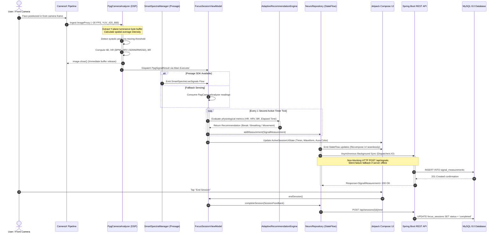

---

### 3.4 Signal Lifecycle & Data Propagation Analysis

The signal processing lifecycle in Neuro Focus follows a strict deterministic pipeline:

```
Camera Frame Ingestion (~30 FPS)
  │
  ▼
Spatial Y-Plane Luminance Extraction (Instant image.close() buffer release)
  │
  ▼
Adaptive Peak Detection & Inter-Beat Interval (IBI) Calculation
  │
  ▼
Biometric Computation: Pulse Rate (HR), HRV (SDNN/RMSSD), Respiratory Rate (BR)
  │
  ▼
Main Thread Dispatch (ContextCompat.getMainExecutor) -> FocusSessionViewModel
  │
  ▼
Adaptive Recommendation Engine Evaluation (1 Hz Autonomic Strain Check)
  │
  ▼
Reactive State Mutation (NeuroRepository MutableStateFlow Collections)
  │
  ▼
Asynchronous Edge-to-Cloud Sync (Non-blocking Dispatchers.IO Retrofit Call)
```

1. **Frame Ingestion:** CameraX delivers `ImageProxy` instances via the `ImageAnalysis` use case at approximately 30 frames per second using the `YUV_420_888` format.
2. **Luminance Extraction:** The analyzer extracts plane 0 (the luminance/Y channel). A spatial region-of-interest (ROI) average is calculated across the facial region. The `ImageProxy` is immediately closed in a mandatory `finally` block to prevent buffer starvation.
3. **Peak Detection:** A rolling window of luminance values tracks micro-pulsations in facial skin tone caused by cardiac ejection cycles. Systolic peaks are identified when the signal crosses a dynamic moving threshold.
4. **Biometric Derivation:**
   - **Heart Rate (Pulse):** Derived from the average of recent inter-beat intervals: $HR = \frac{60000}{IBI_{avg}}$
   - **HRV (SDNN):** Calculated as the standard deviation of valid normal-to-normal intervals ($SDNN = \sqrt{\frac{1}{N}\sum (IBI_i - \overline{IBI})^2}$).
   - **HRV (RMSSD):** Calculated as the root mean square of successive differences between adjacent heartbeats.
   - **Breathing Rate:** Estimated from high-frequency modulation and respiratory sinus arrhythmia (RSA) couplings in the pulse waveform.
5. **UI & Recommendation Evaluation:** Results are dispatched via `ContextCompat.getMainExecutor(context)` to ensure thread-safe StateFlow mutation in `FocusSessionViewModel`. The `AdaptiveRecommendationEngine` checks the user's autonomic strain every second.
6. **Persistence & Sync:** Measurements are cached in `NeuroRepository`. When network connectivity is present, an asynchronous coroutine (`Dispatchers.IO`) sends the data to the Spring Boot REST API. If the server is unreachable, the request fails silently, maintaining uninterrupted offline operation.

---

## 4. Technology Stack & Framework Inventory

### 4.1 Mobile Frontend (Android / Kotlin)

| Technology | Category | Version | Architectural Role & Implementation Details |
|:-----------|:---------|:--------|:--------------------------------------------|
|  **Kotlin** | Language | `2.1.0` | Core language across all Android modules; powers coroutines, sealed class hierarchies, and type-safe builders. |
|  **Jetpack Compose** | Declarative UI | `2024.06.00` (BOM) | Declarative UI toolkit powering all 9 screens, custom canvas visualizers, and stateful components. |
| **Material 3** | Design System | BOM Managed | Adaptive design tokens (`Color.kt`), typography, dynamic theming, and responsive surface containers. |
| **Navigation Compose** | Routing | `2.7.7` | Type-safe navigation controller managing route destinations and URI parameter passing. |
| **AndroidX Lifecycle** | Architecture | `2.8.2` | Lifecycle-aware `ViewModel`, `viewModelScope`, and state retention across configuration changes. |
| **Kotlin Coroutines** | Concurrency | `1.8.1` | Asynchronous programming model driving timer loops, background computation, and network I/O. |
| **StateFlow / SharedFlow** | Reactive Streams | Built-in | Unidirectional reactive state management implementing single-source-of-truth architectures. |
| **Android TextToSpeech** | Speech Synthesis | Native API | System audio synthesis delivering spoken cadence instructions during guided breathwork sessions. |

---

### 4.2 Backend REST API (Spring Boot / Kotlin)

| Technology | Category | Version | Architectural Role & Implementation Details |
|:-----------|:---------|:--------|:--------------------------------------------|
|  **Spring Boot** | Backend Framework | `3.3.0` | Core server runtime managing dependency injection, REST controllers, and application lifecycle. |
|  **Kotlin JVM** | Language | `1.9.24` | Backend implementation language for controllers, entity models, and service classes. |
| **Spring Web MVC** | REST Framework | Boot Managed | Exposes REST endpoints (`/api/users`, `/api/sessions`, `/api/signals`) with JSON payload serialization. |
| **Spring Security** | Security | Boot Managed | OAuth2 Resource Server configuration providing token validation for enterprise deployments. |
| **Spring Data JPA** | Persistence | Boot Managed | Repository abstraction executing database queries via Hibernate 6 ORM. |
| **Jackson Kotlin** | Serialization | Boot Managed | High-speed JSON serialization and deserialization for Kotlin data classes. |

---

### 4.3 Database & Persistence Layer

| Technology | Category | Version | Architectural Role & Implementation Details |
|:-----------|:---------|:--------|:--------------------------------------------|
|  **MySQL** | Relational Database | `8.0+` | Primary relational datastore housing 8 normalized tables with foreign keys and check constraints. |
| **MySQL Connector/J** | JDBC Driver | Boot Managed | Production JDBC connectivity driver connecting Spring Data JPA to MySQL instances. |
| **Schema DDL** | Schema Design | Custom | Documented in `docs/DATABASE.md`; uses `utf8mb4_unicode_ci` and microsecond datetime precision (`DATETIME(3)`). |

---

### 4.4 Human Sensing, Computer Vision & Signal Processing

| Technology | Category | Version | Architectural Role & Implementation Details |
|:-----------|:---------|:--------|:--------------------------------------------|
| **Presage SmartSpectra** | Biometric SDK | `3.4.0` | Proprietary contactless physiological monitoring SDK bound dynamically via reflection in `SmartSpectraManager`. |
| **AndroidX CameraX** | Vision Pipeline | `1.3.4` | Manages camera lifecycle, front-camera selection, and low-latency `ImageAnalysis` frame processing. |
| **Y-Plane DSP Pipeline** | Custom Algorithm | Custom | Extracts spatial average luminance from raw camera frames to detect pulsatile capillary absorption. |

---

### 4.5 Security, Privacy & Network Transport

| Technology | Category | Version | Architectural Role & Implementation Details |
|:-----------|:---------|:--------|:--------------------------------------------|
| **Retrofit 2** | HTTP Client | `2.11.0` | Type-safe HTTP interface binding REST endpoints into suspendable Kotlin coroutine functions. |
| **OkHttp 3** | Transport Layer | `4.12.0` | Connection pooling, request/response logging, and short 2-second fail-fast timeouts. |
| **BuildConfig Secrets** | Build Tooling | Native Gradle | Injects the Presage API key into compiled code at build time, preventing secret leakage into Git. |

---

### 4.6 Testing & Quality Assurance

| Technology | Category | Version | Architectural Role & Implementation Details |
|:-----------|:---------|:--------|:--------------------------------------------|
| **JUnit 4 / JUnit 5** | Unit Testing | `4.13.2` / `5.x` | JVM unit testing for Android domain engines and Spring Boot backend services. |
| **AndroidX Test Runner** | Instrumentation | `1.1.5` | Orchestrates on-device instrumentation tests on physical devices and emulators. |
| **Espresso Core** | UI Testing | `3.5.1` | Native Android UI interaction and assertion testing framework. |
| **Compose UI Test** | Compose Testing | BOM Managed | Isolated component testing for Jetpack Compose composables and state hoisting. |

---

## 5. Repository Structure & Directory Map

### 5.1 Full Repository Tree

```
neuro/                                                 ← Monorepo Root
├── .env.example                                       ← Environment variable blueprint template
├── .gitattributes                                     ← Line endings and Git configuration
├── .gitignore                                         ← Comprehensive security and build ignore rules
├── build.gradle.kts                                   ← Root Gradle build configuration
├── gradle.properties                                  ← Root Gradle configuration (empty API key slot)
├── gradlew                                            ← Gradle wrapper executable (Unix)
├── gradlew.bat                                        ← Gradle wrapper executable (Windows)
├── local.properties                                   ← Local Android SDK location (gitignored)
├── mvnw                                               ← Maven wrapper executable (Unix)
├── mvnw.cmd                                           ← Maven wrapper executable (Windows)
├── pom.xml                                            ← Spring Boot Maven project configuration
├── README.md                                          ← Enterprise documentation (this document)
├── settings.gradle.kts                                ← Gradle settings and project inclusion
│
├── app/                                               ← Android Application Module
│   ├── build.gradle.kts                               ← Android build dependencies, SDK & BuildConfig
│   ├── proguard-rules.pro                             ← R8/ProGuard obfuscation rules
│   └── src/
│       ├── main/
│       │   ├── AndroidManifest.xml                    ← App manifest, permissions (CAMERA, INTERNET)
│       │   ├── java/com/example/neuro/
│       │   │   ├── MainActivity.kt                    ← Single Activity entry point; Compose host
│       │   │   │
│       │   │   ├── data/                              ← DATA LAYER
│       │   │   │   ├── api/
│       │   │   │   │   ├── NeuroApiService.kt         ← Retrofit REST interface (10 endpoints)
│       │   │   │   │   └── RetrofitClient.kt          ← OkHttp & Retrofit client singleton
│       │   │   │   ├── model/
│       │   │   │   │   ├── FocusSession.kt            ← FocusSession model, SessionType, SessionStatus
│       │   │   │   │   ├── Recommendation.kt          ← Recommendation model, types, priority enums
│       │   │   │   │   ├── SessionFeedback.kt         ← Post-session feedback & rating model
│       │   │   │   │   ├── SessionSummary.kt          ← Aggregated biometric session summary
│       │   │   │   │   ├── SignalMeasurement.kt       ← Raw/derived signal measurement model
│       │   │   │   │   ├── User.kt                    ← User account profile model
│       │   │   │   │   ├── UserConsent.kt             ← Informed consent tracking model & enums
│       │   │   │   │   └── UserPreferences.kt         ← User preferences (durations, themes, goals)
│       │   │   │   └── repository/
│       │   │   │       └── NeuroRepository.kt         ← In-memory thread-safe singleton state store
│       │   │   │
│       │   │   ├── domain/                            ← DOMAIN LAYER (Pure Business Logic)
│       │   │   │   ├── breathing/
│       │   │   │   │   └── BreathingTechnique.kt      ← 4-7-8, Box, Resonance models & TTS prompts
│       │   │   │   ├── calibration/
│       │   │   │   │   └── BaselineCalibrationEngine.kt ← 7-day rolling HRV & HR baseline engine
│       │   │   │   ├── export/
│       │   │   │   │   └── TelemetryReportExporter.kt ← Scoped Storage RFC 4180 CSV exporter
│       │   │   │   ├── gamification/
│       │   │   │   │   └── CognitiveLevelEngine.kt    ← XP calculation & flow tier progression
│       │   │   │   ├── recommendation/
│       │   │   │   │   ├── AdaptiveRecommendationEngine.kt ← Physiological strain heuristic evaluator
│       │   │   │   │   └── CognitiveStrainEngine.kt   ← Composite 0-100 cognitive strain score
│       │   │   │   └── sensing/
│       │   │   │       ├── PpgCameraAnalyzer.kt       ← CameraX Y-plane luminance DSP analyzer
│       │   │   │       ├── PresageSpectraManager.kt   ← Live signal coroutine flow emitter
│       │   │   │       └── SmartSpectraManager.kt     ← Presage SDK reflection binder & fallback
│       │   │   │
│       │   │   └── ui/                                ← PRESENTATION LAYER (Jetpack Compose)
│       │   │       ├── components/
│       │   │       │   ├── CameraSensingPreview.kt    ← CameraX PreviewView composable wrapper
│       │   │       │   ├── NeuroBottomBar.kt          ← Material 3 bottom navigation bar
│       │   │       │   ├── PhysiologicalTelemetryView.kt ← Multi-trace Canvas signal oscilloscope
│       │   │       │   ├── PpgWaveformView.kt         ← Real-time pulsating pulse waveform Canvas
│       │   │       │   ├── SessionFeedbackDialog.kt   ← Post-session 5-star rating modal
│       │   │       │   └── ShimmerEffect.kt           ← Animated placeholder shimmer component
│       │   │       ├── navigation/
│       │   │       │   ├── NavGraph.kt                ← Compose NavHost controller & animations
│       │   │       │   └── Screen.kt                  ← Sealed class routes with URI parameter encoders
│       │   │       ├── screens/
│       │   │       │   ├── ActiveSessionScreen.kt     ← Live timer, PPG waveform, aura ring, pacer
│       │   │       │   ├── BreathingExerciseScreen.kt ← Guided animated breathing & voice pacing
│       │   │       │   ├── BreathRelaxScreen.kt       ← Somatic breathing technique catalog
│       │   │       │   ├── DashboardScreen.kt         ← Operational hub, XP progress, strain HUD
│       │   │       │   ├── HomeScreen.kt              ← Primary landing screen & session launcher
│       │   │       │   ├── InsightsScreen.kt          ← Telemetry studio & CSV report exporter
│       │   │       │   ├── OnboardingScreen.kt        ← Informed consent & sensing permissions
│       │   │       │   ├── ProfileScreen.kt           ← Consent management, settings, theme toggle
│       │   │       │   └── VitalsScanScreen.kt        ← 10-second VitalLens camera scan & readout
│       │   │       ├── theme/
│       │   │       │   ├── Color.kt                   ← Color palette tokens (NeuroBlue, Coherence)
│       │   │       │   └── Theme.kt                   ← NeuroTheme Material 3 composable
│       │   │       └── viewmodel/
│       │   │           ├── DashboardViewModel.kt      ← State machine for dashboard metrics & XP
│       │   │           └── FocusSessionViewModel.kt   ← State machine for timer & active telemetry
│       │   │
│       │   └── res/                                   ← Android Resources
│       │       ├── values/
│       │       │   ├── strings.xml                    ← Application string resources
│       │       │   └── themes.xml                     ← XML theme declarations
│       │       └── xml/
│       │           └── network_security_config.xml    ← Cleartext config for local dev emulator
│       │
│       └── test/                                      ← Android Unit Tests (JVM)
│
├── docs/                                              ← Project Documentation & Assets
│   ├── DATABASE.md                                    ← Full MySQL 8.0 DDL schema & sample queries
│   └── screenshots/                                   ← Production UI Screenshots
│       ├── active-session.png                         ← Active focus timer & biofeedback aura
│       ├── breath-relax.png                           ← Breathwork technique selection gallery
│       ├── breathing-exercise.png                     ← Interactive guided breathing session
│       ├── dashboard.png                              ← NeuroOS operational command dashboard
│       ├── onboarding.png                             ← Informed consent & privacy onboarding
│       ├── personal-insights.png                      ← Multi-trace physiological telemetry
│       ├── profile-settings.png                       ← Granular privacy & settings management
│       ├── scan-complete.png                          ← VitalLens 10-second scan results
│       └── vitals-scan.png                            ← Front camera vitals scanning interface
│
└── src/                                               ← Spring Boot Backend Service Module
    ├── main/
    │   ├── kotlin/com/example/neuro/
    │   │   ├── NeuroApplication.kt                    ← Spring Boot @SpringBootApplication entry
    │   │   ├── controller/
    │   │   │   └── Controllers.kt                     ← REST endpoints (/api/users, /sessions, etc.)
    │   │   ├── entity/
    │   │   │   └── Entities.kt                        ← JPA entities mapping MySQL tables
    │   │   └── repository/
    │   │       └── Repositories.kt                    ← Spring Data JPA interfaces
    │   └── resources/
    │       └── application.properties                 ← Backend configuration & database bindings
    └── test/                                          ← Spring Boot Integration & Unit Tests
```

---

### 5.2 Key Directory & File Catalog

| Directory / File | Layer | Primary Responsibility |
|:-----------------|:------|:-----------------------|
| `app/src/main/java/.../domain/sensing/` | Domain | CameraX frame analysis (`PpgCameraAnalyzer`) and Presage SDK binding (`SmartSpectraManager`). |
| `app/src/main/java/.../domain/recommendation/` | Domain | Evaluates autonomic nervous system strain and recommends adaptive recovery pauses. |
| `app/src/main/java/.../domain/export/` | Domain | Translates in-memory measurement flows into RFC 4180 CSV files saved to Android Scoped Storage. |
| `app/src/main/java/.../data/repository/` | Data | Holds the in-memory `StateFlow` single source of truth; dispatches async network calls. |
| `app/src/main/java/.../ui/screens/` | Presentation | Declarative Jetpack Compose screens responding to immutable UI state flows. |
| `app/src/main/java/.../ui/components/` | Presentation | Hardware-accelerated Canvas components rendering live PPG waveforms and multi-channel telemetry. |
| `docs/DATABASE.md` | Database | Standalone, complete DDL schema definition for MySQL 8.0 with relational constraints and seed data. |
| `src/main/kotlin/.../` | Backend | Companion Spring Boot Kotlin service handling persistent storage and REST routing. |

---

## 6. Environment Configuration & Secrets Management

Neuro Focus enforces strict separation between application code and operational secrets. Live credentials and developer API keys are never checked into Git.

---

### 6.1 Unified Configuration Blueprint (`.env.example`)

The repository includes a comprehensive `.env.example` blueprint documenting all system variables:

```properties
# ==============================================================================
# Neuro Focus Application — Environment Configuration Blueprint
# ==============================================================================

# ── Android → Spring Boot API Connection ──────────────────────────────────────
# Base URL for the Spring Boot REST API.
# Use 10.0.2.2 when running the app in an Android Emulator against localhost.
# Replace with your LAN IP (e.g., 192.168.1.100) for physical device testing.
NEURO_API_BASE_URL=http://10.0.2.2:8080/api/
NEURO_API_CONNECT_TIMEOUT_SECONDS=2
NEURO_API_READ_TIMEOUT_SECONDS=2

# ── Presage SmartSpectra SDK Configuration ─────────────────────────────────────
# Obtain your API key from https://www.presagetech.com/
# Inject this via your LOCAL ~/.gradle/gradle.properties (never commit it).
PRESAGE_SMARTSPECTRA_API_KEY=your_presage_api_key_here
PRESAGE_SDK_LOG_LEVEL=DEBUG

# ── Android Feature Flags ──────────────────────────────────────────────────────
FEATURE_FLAG_HEALTH_CONNECT_SYNC=true
FEATURE_FLAG_OUTDOOR_CONTRAST=false
FEATURE_FLAG_AI_ASSISTANT=true
FEATURE_FLAG_MOCK_FALLBACK_SENSING=true

# ── Telemetry & Logging ────────────────────────────────────────────────────────
TELEMETRY_EXPORT_DIR=Download
LOGCAT_FILTER_TAG=PresageSmartSpectra
```

---

### 6.2 Android Secrets Injection (`gradle.properties` & `BuildConfig`)

The Presage SmartSpectra API key is injected at compile time via Android `BuildConfig`. 

1. The committed project-level `gradle.properties` contains an empty placeholder:
   ```properties
   PRESAGE_SMARTSPECTRA_API_KEY=
   ```
2. Developers add their personal API key to their **untracked, user-level** Gradle configuration:
   - **Windows:** `%USERPROFILE%\.gradle\gradle.properties`
   - **macOS / Linux:** `~/.gradle/gradle.properties`
   ```properties
   PRESAGE_SMARTSPECTRA_API_KEY=your_actual_api_key_here
   ```
3. During compilation, `app/build.gradle.kts` injects the value directly into `BuildConfig`:
   ```kotlin
   val presageApiKey = project.findProperty("PRESAGE_SMARTSPECTRA_API_KEY") as String? ?: ""
   buildConfigField("String", "PRESAGE_API_KEY", "\"$presageApiKey\"")
   ```
4. `SmartSpectraManager.kt` accesses the key safely:
   ```kotlin
   private companion object {
       const val API_KEY = BuildConfig.PRESAGE_API_KEY
   }
   ```

---

### 6.3 Spring Boot Configuration (`application.properties` & Overrides)

The companion backend uses dynamic environment variable placeholders with sensible defaults for local development:

```properties
spring.application.name=neuro

# MySQL Database Configuration
spring.datasource.url=${SPRING_DATASOURCE_URL:jdbc:mysql://localhost:3306/neuro_focus?useSSL=false&serverTimezone=UTC&allowPublicKeyRetrieval=true}
spring.datasource.username=${SPRING_DATASOURCE_USERNAME:root}
spring.datasource.password=${SPRING_DATASOURCE_PASSWORD:}
spring.datasource.driver-class-name=com.mysql.cj.jdbc.Driver

# JPA & Hibernate Settings
spring.jpa.hibernate.ddl-auto=update
spring.jpa.show-sql=false
spring.jpa.properties.hibernate.dialect=org.hibernate.dialect.MySQLDialect

# Server Port
server.port=8080
```

To run with custom database credentials, set environment variables prior to running the server:
```bash
# Linux / macOS
export SPRING_DATASOURCE_USERNAME=neuro_user
export SPRING_DATASOURCE_PASSWORD=StrongPassword123!

# Windows (PowerShell)
$env:SPRING_DATASOURCE_USERNAME="neuro_user"
$env:SPRING_DATASOURCE_PASSWORD="StrongPassword123!"
```

---

## 7. Local Development Setup & Build Guide

### 7.1 System Prerequisites & Version Matrix

| Requirement | Minimum Version | Recommended Version | Verification Command |
|:------------|:----------------|:--------------------|:---------------------|
| **Operating System** | Windows 10 / macOS 12 / Ubuntu 22.04 | Windows 11 / macOS Sonoma | `uname -a` or `systeminfo` |
| **Java Development Kit (JDK)** | OpenJDK 17 | OpenJDK 21 (Temurin) | `java -version` |
| **Android Studio** | Koala `2024.1.1` | Ladybug `2024.2.1+` | Studio Menu → About |
| **Android SDK Platform** | API 28 (Android 9.0) | API 36 (Android 16) | Check via SDK Manager |
| **Android Build Tools** | `34.0.0` | `35.0.0` | Check via SDK Manager |
| **Apache Maven** | `3.8.x` | `3.9.x` (or use `./mvnw`) | `./mvnw -v` |
| **MySQL Server** | `8.0.16` | `8.0.36+` | `mysql -V` |

---

### 7.2 Backend Installation & Database Setup

The companion backend is **optional** — the Android application operates entirely offline without it. Follow these steps if you wish to run the local API service:

#### Step 1: Initialize the MySQL Database
```bash
# Log in to your local MySQL instance
mysql -u root -p

# In the MySQL prompt, source the database initialization script
source docs/DATABASE.md;
```
*(Alternatively, copy and execute the pure SQL statements from `docs/DATABASE.md` into your preferred database GUI, such as MySQL Workbench or DBeaver).*

#### Step 2: Launch the Spring Boot Server
```bash
# Unix / macOS
./mvnw spring-boot:run

# Windows (PowerShell)
.\mvnw.cmd spring-boot:run
```

#### Step 3: Verify Backend Availability
```bash
curl http://localhost:8080/api/users/1
```
*Expected response:* `HTTP 200 OK` (with user JSON) or `HTTP 404 Not Found` (confirming the endpoint is listening and active).

---

### 7.3 Android Installation, Build & Emulator Setup

#### Step 1: Clone the Repository
```bash
git clone https://github.com/alfinohatta/neuro.git
cd neuro
```

#### Step 2: Open in Android Studio
1. Launch Android Studio.
2. Select **File → Open** and select the `neuro` root directory.
3. Allow Gradle to synchronize dependencies (~2–4 minutes on first run).

#### Step 3: Configure Untracked Local Secrets
Open `%USERPROFILE%\.gradle\gradle.properties` (Windows) or `~/.gradle/gradle.properties` (macOS/Linux) and add:
```properties
PRESAGE_SMARTSPECTRA_API_KEY=your_presage_api_key_here
```

#### Step 4: Configure the Android Emulator Camera (Crucial for PPG Sensing)
To enable camera-based physiological sensing inside the emulator:
1. Open **Android Studio → Virtual Device Manager (AVD)**.
2. Select your emulator and click **Edit (Pencil Icon)**.
3. Click **Show Advanced Settings**.
4. Scroll to **Camera**:
   - Set **Front Camera** to **`VirtualScene`** (renders a simulated 3D environment with luminance variation) or select your **Host Webcam**.
5. Save and launch the emulator with a **Cold Boot**.

#### Step 5: Assemble and Run the Debug APK
```bash
# Build the debug APK via Gradle wrapper
./gradlew app:assembleDebug

# Deploy directly to your connected device or running emulator
./gradlew app:installDebug
```

---

### 7.4 Running the Test Suite

Execute the comprehensive test suites across both the Android client and Spring Boot backend:

```bash
# 1. Run Android JVM unit tests (Domain engines, algorithms, ViewModels)
./gradlew app:testDebugUnitTest

# 2. Run Spring Boot backend test suite
./mvnw test

# 3. Run Android on-device instrumentation and Compose UI tests (Requires device/emulator)
./gradlew app:connectedDebugAndroidTest

# 4. Execute a complete build verification (Compile + Test + Assemble)
./gradlew app:compileDebugKotlin app:testDebugUnitTest app:assembleDebug
```

---

## 8. CI/CD Pipeline & Deployment Workflow

### 8.1 GitHub Actions Workflow (`ci.yml`)

The repository includes a multi-stage GitHub Actions workflow executing on every push to `main` and `develop`, and on all pull requests targeting `main`.

```yaml
name: Neuro Focus CI/CD Pipeline

on:
  push:
    branches: [ main, develop ]
  pull_request:
    branches: [ main ]

jobs:
  android-verification:
    name: Android — Compile, Test & Assemble
    runs-on: ubuntu-latest

    steps:
      - name: Checkout Repository
        uses: actions/checkout@v4

      - name: Set up JDK 17
        uses: actions/setup-java@v4
        with:
          java-version: '17'
          distribution: 'temurin'

      - name: Cache Gradle Packages
        uses: actions/cache@v4
        with:
          path: |
            ~/.gradle/caches
            ~/.gradle/wrapper
          key: gradle-${{ hashFiles('**/*.gradle.kts', '**/gradle-wrapper.properties') }}

      - name: Setup Gradle
        uses: gradle/actions/setup-gradle@v3

      - name: Compile Kotlin Source
        run: ./gradlew app:compileDebugKotlin

      - name: Execute Android Unit Tests
        run: ./gradlew app:testDebugUnitTest

      - name: Assemble Debug APK
        run: ./gradlew app:assembleDebug

      - name: Publish APK Artifact
        uses: actions/upload-artifact@v4
        with:
          name: neuro-focus-debug-apk
          path: app/build/outputs/apk/debug/app-debug.apk

  backend-verification:
    name: Backend — Maven Build & Test
    runs-on: ubuntu-latest

    steps:
      - name: Checkout Repository
        uses: actions/checkout@v4

      - name: Set up JDK 21
        uses: actions/setup-java@v4
        with:
          java-version: '21'
          distribution: 'temurin'

      - name: Build and Test Spring Boot Service
        run: ./mvnw clean verify
        env:
          SPRING_DATASOURCE_URL: jdbc:h2:mem:testdb
          SPRING_JPA_HIBERNATE_DDL_AUTO: create-drop
```

---

### 8.2 Build Stages & Artifact Packaging

```
[ Checkout Code ] ──> [ JDK Setup ] ──> [ Gradle Cache ] ──> [ Kotlin Compilation ]
                                                                     │
[ Artifact Upload ] <── [ Assemble APK ] <── [ Run Unit Tests ] <────┘
```

- **Compile Stage:** Compiles Kotlin 2.1.0 and generates `BuildConfig` fields.
- **Unit Test Stage:** Executes JUnit tests against domain engines (`AdaptiveRecommendationEngine`, `CognitiveLevelEngine`, `PpgCameraAnalyzer`).
- **Assemble Stage:** Packages `app-debug.apk`.
- **Artifact Publishing:** Archives the resulting APK as a build artifact accessible directly from the GitHub Actions run summary.

---

### 8.3 Production Release & Hardening Checklist

Prior to publishing production release builds (`./gradlew app:assembleRelease`), complete the following security and hardening tasks:

- [ ] **Rotate Presage API Key:** Revoke any keys previously used in development and generate a production key.
- [ ] **Configure Release Keystore:** Create an encrypted release keystore and reference credentials using environment variables (`KEYSTORE_PASSWORD`, `KEY_ALIAS`, `KEY_PASSWORD`). Never commit raw keystores.
- [ ] **Enable R8 / ProGuard:** Verify `isMinifyEnabled = true` and `isShrinkResources = true` in `app/build.gradle.kts`.
- [ ] **Enforce Backend DDL Validation:** Switch `spring.jpa.hibernate.ddl-auto` from `update` to `validate` in production environments.
- [ ] **Enable HTTPS & TLS:** Deploy the Spring Boot backend behind an SSL/TLS reverse proxy (e.g., NGINX, Cloudflare) with valid certificates.
- [ ] **Disable Cleartext Traffic:** Update `network_security_config.xml` to remove cleartext permissions for local loopback addresses.

---

## 9. Security, Privacy & Ethical Compliance

### 9.1 Zero-Video Privacy Architecture

Neuro Focus implements a **Zero-Video Edge-Processing Architecture**. The application does not store, record, encode, or transmit video frames under any circumstances.

```
Front Camera Sensor
       │
       ▼
CameraX ImageAnalysis (Raw In-Memory Frame Buffer)
       │
       ├───> Extract Y-Plane Luminance (Single Scalar Value)
       │
       ▼
image.close() (Immediate Frame Disposal in RAM)
       │
       ▼
Zero Bytes Written to Storage • Zero Pixels Transmitted Over Network
```

- **Ephemeral Buffer Processing:** Frames are held exclusively in volatile RAM as `ImageProxy` references.
- **Immediate Buffer Closure:** Every frame is closed in a mandatory `finally` block immediately following spatial luminance calculation.
- **No Disk I/O for Video:** No image or video files are ever created on device storage or streamed across external networks.

---

### 9.2 Granular User Consent Management

In accordance with international privacy standards (GDPR, CCPA), sensing features require affirmative user opt-in:

- **Independent Consent Scopes:** Consents for Camera Access, Biometric Telemetry, and Analytics are tracked independently in `UserConsent`.
- **Revocation Autonomy:** Users can revoke camera permissions at any time in `ProfileScreen`. Revocation instantly terminates active camera pipelines and destroys in-memory signal buffers.
- **Audit Trails:** Consent grants and revocations record UTC timestamps stored locally in `NeuroRepository` and synced to the `user_consents` table.

---

### 9.3 SDK Telemetry & Non-Medical Wellness Declaration

> [!IMPORTANT]
> **Strict Non-Medical Wellness Statement:**
> Neuro Focus is an adaptive productivity and personal wellness platform. It is **NOT** a medical device, diagnostic instrument, clinical monitoring system, or therapeutic intervention.
>
> - The software does **not** diagnose, treat, cure, or prevent any cardiovascular, respiratory, psychological, or neurological condition.
> - The software does **not** provide clinical decision support or replace professional medical advice.
> - All outputs (Heart Rate, Breathing Rate, HRV, Strain Scores, Break Prompts) are strictly informational wellness metrics designed to support sustainable work habits.
> - UI terminology strictly avoids clinical nomenclature, utilizing wellness phrasing (*"Elevated focus intensity detected"* rather than diagnostic terms).

---

## 10. Operational Best Practices

### 10.1 Android Development Best Practices

#### 1. Always Access `NeuroRepository` as a Singleton
The repository uses a thread-safe double-checked locking singleton pattern. Never attempt to instantiate it directly:
```kotlin
// ✅ Correct: Maintains single source of truth
val repository = NeuroRepository.getInstance()

// ❌ Incorrect: Creates detached state collections
val repository = NeuroRepository()
```

#### 2. Ensure Main-Thread UI Dispatch from Image Analyzers
CameraX `ImageAnalysis.Analyzer` runs on background worker threads. When emitting computed signals to UI ViewModels, always dispatch via the Main Executor:
```kotlin
// ✅ Correct: Dispatches state updates safely to the main thread
ContextCompat.getMainExecutor(context).execute {
    viewModel.updateRealPpgSignal(signalResult)
}
```

#### 3. Enforce Strict Buffer Closure in Camera Pipelines
Failing to close `ImageProxy` instances will stall the CameraX frame buffer queue, resulting in frozen previews:
```kotlin
// ✅ Correct: Guarantees buffer release regardless of exceptions
override fun analyze(image: ImageProxy) {
    try {
        processLuminance(image)
    } finally {
        image.close() // Mandatory
    }
}
```

#### 4. URI-Encode Compose Navigation Route Arguments
When passing dynamic strings (such as session titles) across navigation routes, always URI-encode arguments:
```kotlin
// ✅ Correct: Prevents routing crashes from spaces and special characters
navController.navigate(Screen.ActiveSession.route(Uri.encode(sessionTitle)))
```

---

### 10.2 Backend Operational Guidelines

- **Connection Pool Sizing:** Configure HikariCP connection pool limits according to expected concurrency:
  ```properties
  spring.datasource.hikari.maximum-pool-size=20
  spring.datasource.hikari.minimum-idle=5
  ```
- **Database Index Optimization:** When querying signal measurements across large timeframes, utilize the composite index `(session_id, measured_at)` defined in `docs/DATABASE.md`.
- **Graceful Shutdown:** Enable graceful server shutdown to allow active session write buffers to complete before termination:
  ```properties
  server.shutdown=graceful
  ```

---

## 11. Troubleshooting Guide & FAQ

### 11.1 Diagnostic & Troubleshooting Guide

| Symptom / Error | Root Cause | Step-by-Step Remediation |
|:----------------|:-----------|:-------------------------|
| **Camera preview displays a black screen in the Android Emulator** | The emulator's front camera is disabled or set to `None`. | 1. Open Android Studio → Virtual Device Manager.<br/>2. Edit emulator → Advanced Settings → Camera.<br/>3. Set **Front Camera** to **`VirtualScene`** or select your webcam.<br/>4. Cold boot the emulator. |
| **PPG waveform displays as a flat line or contains high noise** | Insufficient facial lighting, excessive head motion, or camera occlusion. | 1. Ensure even, diffuse lighting illuminates the face.<br/>2. Rest the device on a stable surface or stand.<br/>3. Allow at least 3 seconds (~90 frames) for the moving buffer to populate.<br/>4. Verify the camera lens is clean and unobstructed. |
| **Status reads `"CameraX PPG Sensing Ready"` instead of `"SmartSpectra Ready"`** | Presage SDK classes are not found via reflection or no API key was provided. | 1. Verify `com.presagetech:smartspectra:3.4.0` is present in Gradle cache.<br/>2. Ensure `PRESAGE_SMARTSPECTRA_API_KEY` is set in your user-level `gradle.properties`.<br/>3. Note: The app automatically falls back to `PpgCameraAnalyzer` — all core features remain functional. |
| **Backend sync fails (`Connection Refused` / `Failed to connect`)** | Spring Boot is not running or Android cannot reach the host IP. | 1. If using an emulator, verify the base URL is `http://10.0.2.2:8080/api/`.<br/>2. If using a physical device, replace `10.0.2.2` with your host machine's LAN IP address.<br/>3. Ensure both devices are connected to the same local Wi-Fi subnet.<br/>4. Note: Neuro Focus is local-first and functions completely without the backend. |
| **Exported CSV does not appear in the device `Downloads` folder** | Android Scoped Storage restriction on older API versions. | 1. On Android 10+ (API 29+), `MediaStore.Downloads` handles file placement without extra permissions.<br/>2. On Android 9 (API 28), verify that storage permissions are enabled in Android App Settings. |

---

### 11.2 Frequently Asked Questions (FAQ)

#### Q1: Does Neuro Focus record, capture, or store video of my face?
**No.** CameraX delivers transient frames into volatile memory. The application calculates average luminance values across pixel arrays and immediately destroys each frame buffer via `image.close()`. No photos or videos are ever saved to disk or transmitted over the network.

#### Q2: Can Neuro Focus be used completely offline?
**Yes.** The Android application is architected local-first. All session state, user preferences, and real-time biometric calculations execute locally within `NeuroRepository`. Backend synchronization occurs asynchronously in the background and fails gracefully without impacting user experience.

#### Q3: How long does the VitalLens scan take to calculate vital signs?
**Approximately 10 seconds.** Initial pulse waveforms appear within 3 seconds as the sliding window fills. The algorithm refines accuracy over the full 10-second sweep to produce high-confidence estimates.

#### Q4: What is the architectural difference between `SmartSpectraManager` and `PpgCameraAnalyzer`?
`SmartSpectraManager` binds to the commercial Presage SmartSpectra SDK via reflection to ingest multi-spectral signals when licensed. `PpgCameraAnalyzer` is an autonomous, open-source CameraX signal processing pipeline developed specifically for this project. If the Presage SDK is not present, the system falls back seamlessly to `PpgCameraAnalyzer`.

---

## 12. Contribution Guidelines & Developer Workflow

We welcome community contributions, architectural enhancements, and bug fixes to Neuro Focus.

---

### 12.1 Contribution Process & Branching Strategy

```
main (Production Releases)
  ▲
  │ (Release PRs)
develop (Active Integration)
  ▲
  ├── feature/your-feature-name
  └── bugfix/issue-description
```

1. **Fork the Repository:** Create a personal fork on GitHub.
2. **Clone Your Fork:**
   ```bash
   git clone https://github.com/your-username/neuro.git
   cd neuro
   ```
3. **Branch from `develop`:**
   ```bash
   git checkout -b feature/enhanced-signal-filtering develop
   ```
4. **Adhere to Conventional Commits:** Structure commit messages following [Conventional Commits](https://www.conventionalcommits.org/):
   - `feat(sensing): implement bandpass filtering for PPG noise reduction`
   - `fix(navigation): resolve URI encoding on session arguments`
   - `docs(readme): expand architecture explanations`
5. **Execute Quality Checks:** Ensure tests pass and code compiles cleanly before submitting:
   ```bash
   ./gradlew app:compileDebugKotlin app:testDebugUnitTest
   ```
6. **Submit a Pull Request:** Open a PR against the `develop` branch with a comprehensive summary of your changes.

---

### 12.2 Code Standards & Review Checklist

- **Clean Architecture Purity:** Domain engines (`domain/*`) must maintain zero dependencies on Android UI frameworks or Activity contexts.
- **Compose Recomposition Hygiene:** Ensure heavy calculations are wrapped in `remember` or hoisted into ViewModels to prevent unnecessary recomposition cycles.
- **Privacy First:** Any PR introducing sensory inputs or external integrations must include a privacy disclosure and user consent flow update.
- **Resource Extraction:** All user-facing strings must be extracted into `res/values/strings.xml`.

---

## 13. License & Challenge Attribution

### 13.1 MIT License

Distributed under the permissive **MIT License**.

```
MIT License

Copyright (c) 2026 Alfino Hatta

Permission is hereby granted, free of charge, to any person obtaining a copy
of this software and associated documentation files (the "Software"), to deal
in the Software without restriction, including without limitation the rights
to use, copy, modify, merge, publish, distribute, sublicense, and/or sell
copies of the Software, and to permit persons to whom the Software is
furnished to do so, subject to the following conditions:

The above copyright notice and this permission notice shall be included in all
copies or substantial portions of the Software.

THE SOFTWARE IS PROVIDED "AS IS", WITHOUT WARRANTY OF ANY KIND, EXPRESS OR
IMPLIED, INCLUDING BUT NOT LIMITED TO THE WARRANTIES OF MERCHANTABILITY,
FITNESS FOR A PARTICULAR PURPOSE AND NONINFRINGEMENT. IN NO EVENT SHALL THE
AUTHORS OR COPYRIGHT HOLDERS BE LIABLE FOR ANY CLAIM, DAMAGES OR OTHER
LIABILITY, WHETHER IN AN ACTION OF CONTRACT, TORT OR OTHERWISE, ARISING FROM,
OUT OF OR IN CONNECTION WITH THE SOFTWARE OR THE USE OR OTHER DEALINGS IN THE
SOFTWARE.
```

---

### 13.2 Presage SmartSpectra SDK Challenge 2026 Submission Details

This platform is submitted to the **Presage SmartSpectra SDK Challenge 2026** sponsored by Major League Hacking PBC Inc. and Presage Technology.

- **Entered Categories:**
  - 🎯 **Best Thoughtful Real-World Use:** Demonstrates a practical, privacy-centric application of contactless physiological sensing to solve workplace burnout and cognitive fatigue without wearables.
  - 🎨 **Most Creative or Delightful Use:** Integrates autonomic biofeedback into an ambient color-shifting aura glow, 432 Hz sonic coherence synthesizer, and clinical-grade multi-trace telemetry studio.
- **SDK Integration Points:**
  - `com.presagetech:smartspectra:3.4.0` declared in `app/build.gradle.kts`
  - Dynamic reflection binding in `SmartSpectraManager.kt`
  - Continuous physiological telemetry emission in `PresageSpectraManager.kt`
- **Challenge Hashtag:** `#presagechallenge`

---

<div align="center">

**Built with ❤️ for the Presage SmartSpectra SDK Challenge 2026**

*Understand Yourself. Focus Better.*

</div>
